
<picture>
  <source media="(prefers-color-scheme: dark)" srcset="assets/readme-kit/header-projects-dark.svg">
  <source media="(prefers-color-scheme: light)" srcset="assets/readme-kit/header-projects-light.svg">
  
</picture>

<a href="https://werkbank-gamma.vercel.app"></a>
<a href="https://github.com/omkar-k0/cuddly-octo-palm-tree"></a>
<a href="https://guidance-reconciliation-engine.vercel.app"></a>
<a href="https://github.com/omkar-k0/laufbahn"></a>
<a href="https://github.com/omkar-k0/gradelens"></a>
<a href="https://github.com/omkar-k0/lookmatch"></a>

<picture>
  <source media="(prefers-color-scheme: dark)" srcset="assets/readme-kit/header-numbers-dark.svg">
  <source media="(prefers-color-scheme: light)" srcset="assets/readme-kit/header-numbers-light.svg">
  
</picture>

<picture>
  <source media="(prefers-color-scheme: dark)" srcset="assets/readme-kit/header-connect-dark.svg">
  <source media="(prefers-color-scheme: light)" srcset="assets/readme-kit/header-connect-light.svg">
  
</picture>


Cards rendered with <a href="https://github.com/Sagargupta16/readme-kit-action">readme-kit</a> (MIT).
